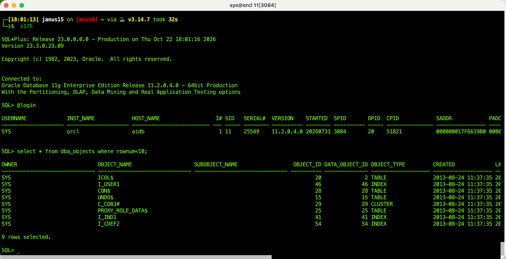
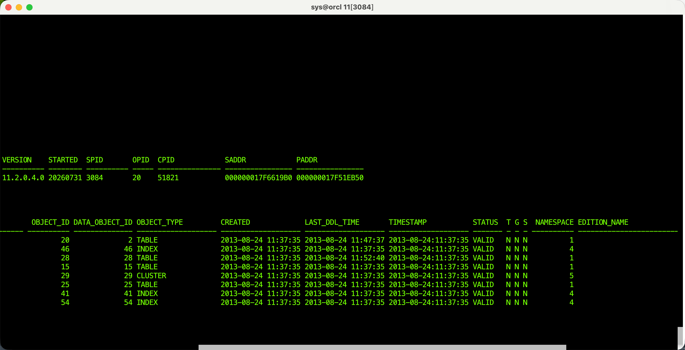

# Terminator M4

An Apple Silicon macOS build of the upstream Jessies Terminator, packaged as a separate app for viewing long SQL*Plus output lines with a horizontal scrollbar.

This project is derived from the Java Terminator component in [`software-jessies-org/jessies`](https://github.com/software-jessies-org/jessies), starting from upstream commit [`fa4fbaff1e51af5f075b0d4aef0299774c004a1a`](https://github.com/software-jessies-org/jessies/commit/fa4fbaff1e51af5f075b0d4aef0299774c004a1a). The commit identifies the exact source snapshot used as the starting point; it is not a software version number. This project adds Apple Silicon/macOS launcher and packaging compatibility changes. See [`COPYING`](COPYING) and the upstream project for source and license history.

The similarly named [`nelk114/terminator`](https://github.com/nelk114/terminator) is a separate, small C/X11 session-termination utility. It is not the terminal emulator used here and was not used to build this app.

## Screenshots

These screenshots show SQL*Plus output at the left edge and after scrolling horizontally to the right.

The app uses the independent bundle identifier `org.jessies.TerminatorM4` and the configuration directory `~/.terminator-m4`.

## Build and use

See [README-M4.md](README-M4.md) for requirements, build steps, and local test notes. The generated `.app` and scratch test data are intentionally excluded from Git; build the app locally from source.

## Dependencies and licenses

The source tree is distributed under its existing licenses. The bundled Apple Java Extensions and Swing Worker libraries retain their accompanying license texts in `salma-hayek/lib/jars/`.
